<div align="center">

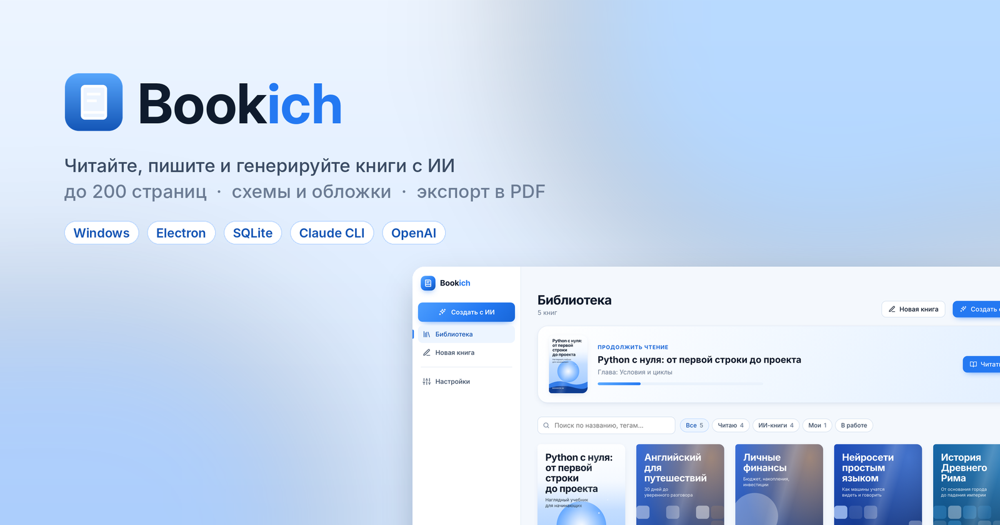

<h3>Десктопная библиотека, читалка и ИИ-генератор книг для Windows</h3>

<p>
  
  
  
  
  
  
</p>

<p>
  <a href="#-быстрый-старт">Быстрый старт</a> ·
  <a href="#-возможности">Возможности</a> ·
  <a href="#-скриншоты">Скриншоты</a> ·
  <a href="#-концепция">Концепция</a> ·
  <a href="#-подключение-ии">Подключение ИИ</a> ·
  <a href="#-архитектура">Архитектура</a>
</p>

</div>

---

## 💡 О проекте

**Bookich** превращает идею в готовую книгу. Опишите, что хотите изучить или прочитать, и ИИ спроектирует содержание, нарисует обложку и напишет книгу объёмом до 200 страниц с поясняющими схемами, таблицами и примерами. Готовую книгу можно читать прямо в приложении, редактировать вручную и экспортировать в PDF.

Главный принцип: **человек управляет структурой, ИИ пишет текст**. Вы утверждаете содержание до того, как потрачен хотя бы один токен на главы, правите его точечно, а книга генерируется небольшими кусками, которые можно остановить и продолжить в любой момент.

> Все книги хранятся локально в SQLite. Работает через **Claude CLI** (ваша подписка Claude, без API-ключа) или **OpenAI API**.

## ✨ Возможности

<table>
<tr>
<td width="50%" valign="top">

### 🤖 ИИ-генерация
- Книга по одному промпту: учебник, гайд, нон-фикшн, художественная, справочник
- Объём от 5 до **200 страниц**, выбор уровня читателя и языка
- Сначала **содержание, теги и мини-аннотация**, потом текст
- Метки глав: *Рекомендуется*, *Интересно*, *Основа*, *Практика*, *Углублённо*, *Необязательно*
- **Перегенерация** всего содержания с комментарием и **точечная ИИ-правка** одной главы
- История вариантов содержания с восстановлением
- Режим **«Больше визуала»**: SVG-схемы, таблицы и выноски в каждом разделе
- Иллюстрации к главам (OpenAI Images)

</td>
<td width="50%" valign="top">

### 📚 Чтение и работа с книгами
- Библиотека с обложками, поиском и фильтрами
- Читалка: оглавление, размер и тип шрифта, ширина колонки, сохранение позиции
- Редактор Markdown с живым предпросмотром
- Вставка таблиц, кода, выносок, SVG-схем и изображений
- ИИ-правка любого раздела по инструкции
- **Экспорт в PDF** (A4, A5, Letter): обложка, оглавление, номера страниц, закладки
- Экспорт в Markdown
- Обложки: ИИ-изображение, векторный SVG-арт, своё фото или автоузор

</td>
</tr>
</table>

### ⏯️ Генерация по частям

| Режим | Что происходит |
|---|---|
| **Вся книга** | Программа сама делит книгу на куски около 1000 слов и пишет их по порядку |
| **Только N страниц** | Выпускает нужное количество страниц сейчас, остальное можно дописать позже |
| **Выбранные главы** | Генерирует или перегенерирует конкретные главы |

Прогресс сохраняется после каждого куска: генерацию можно поставить на паузу, закрыть программу и продолжить с того же места.

## 📸 Скриншоты

<p align="center">
  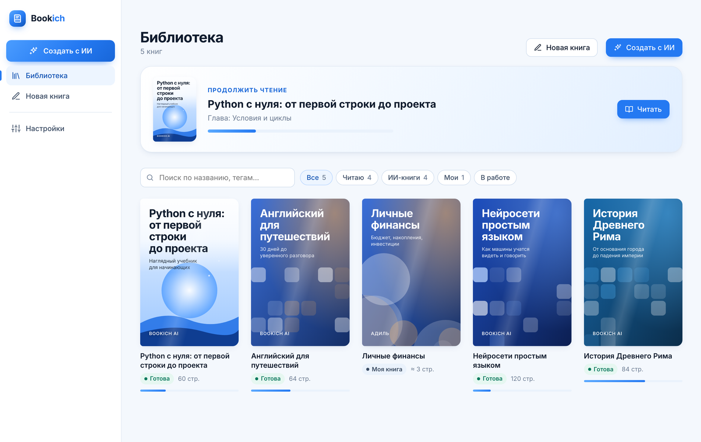
  <br/><sub><b>Библиотека</b> с блоком «Продолжить чтение», фильтрами и обложками</sub>
</p>

<table>
<tr>
<td width="50%">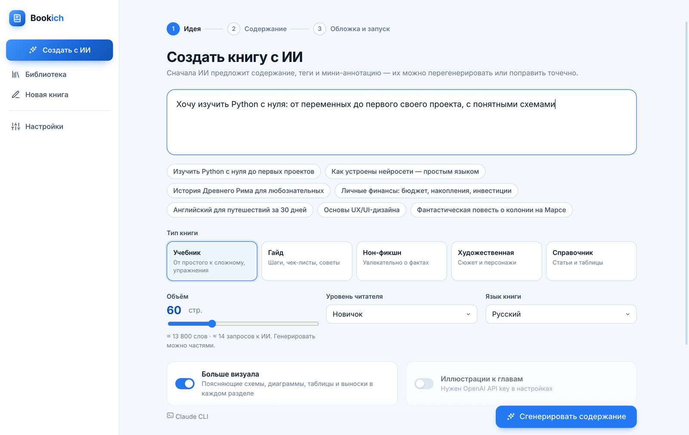<p align="center"><sub><b>Шаг 1. Идея:</b> промпт, тип книги, объём, визуал</sub></p></td>
<td width="50%">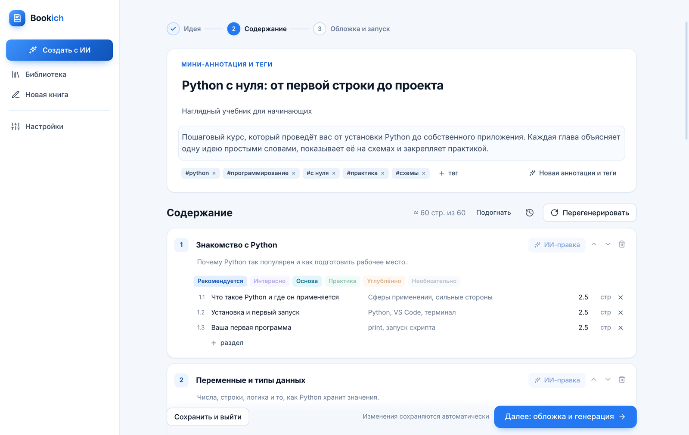<p align="center"><sub><b>Шаг 2. Содержание:</b> аннотация, теги, метки глав, ИИ-правка</sub></p></td>
</tr>
<tr>
<td width="50%">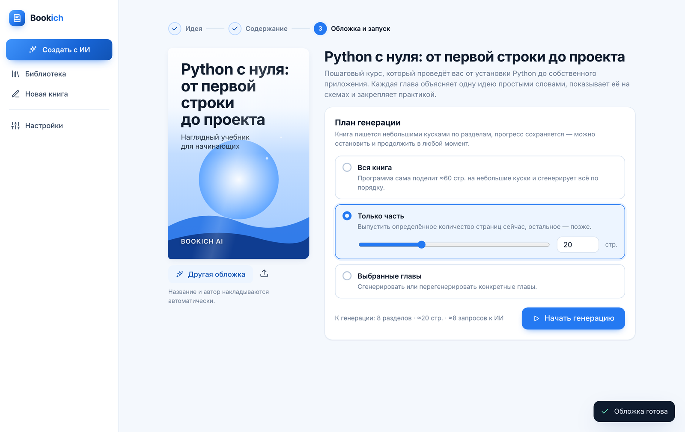<p align="center"><sub><b>Шаг 3. Обложка и план генерации</b></sub></p></td>
<td width="50%">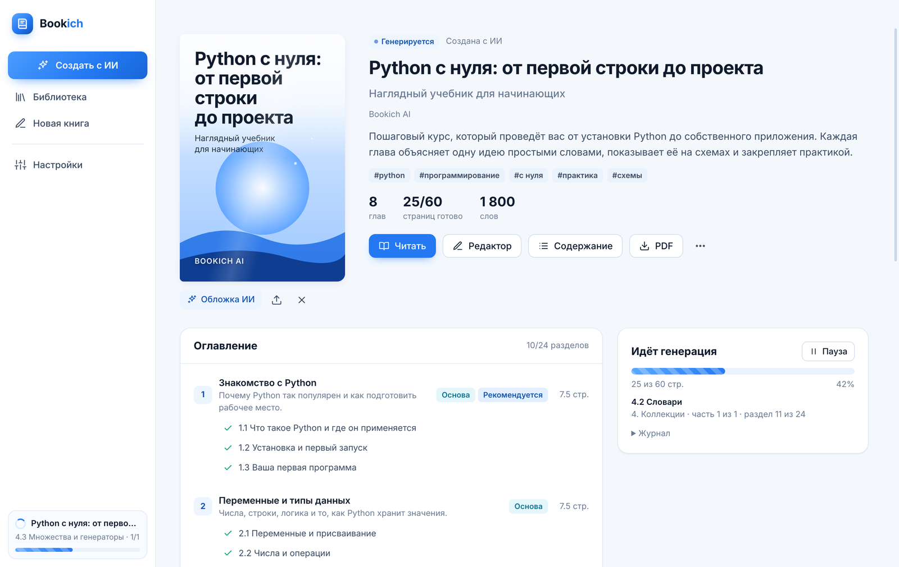<p align="center"><sub><b>Генерация по кускам</b> с прогрессом и паузой</sub></p></td>
</tr>
<tr>
<td width="50%">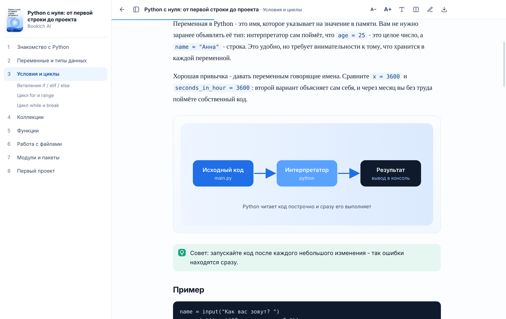<p align="center"><sub><b>Читалка</b> со схемами, выносками и кодом</sub></p></td>
<td width="50%">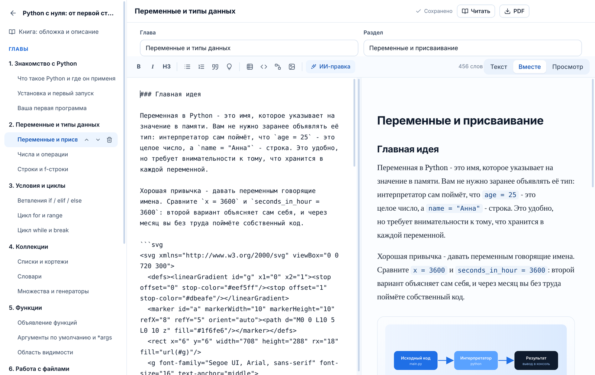<p align="center"><sub><b>Редактор</b> Markdown с живым предпросмотром</sub></p></td>
</tr>
</table>

<p align="center">
  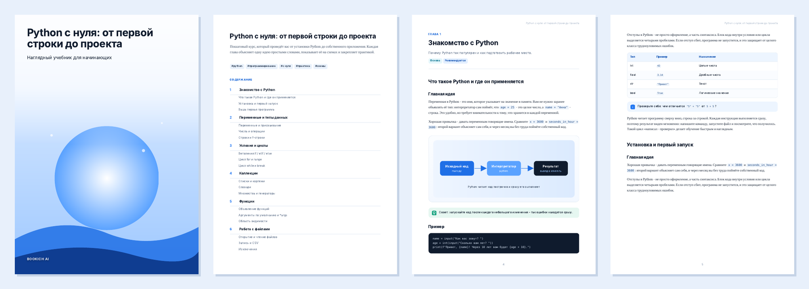
  <br/><sub><b>Экспорт в PDF:</b> обложка на всю страницу, оглавление, векторные схемы. <a href="docs/sample.pdf">Пример PDF</a></sub>
</p>

<details>
<summary><b>Настройки</b></summary>
<br/>
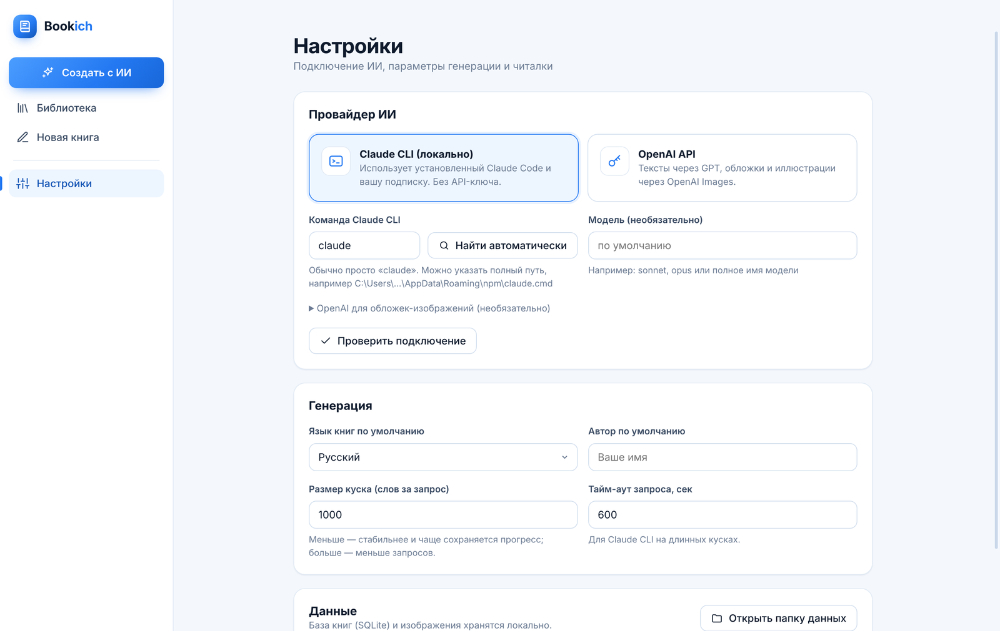
</details>

## 🧭 Концепция

### Путь от идеи до книги

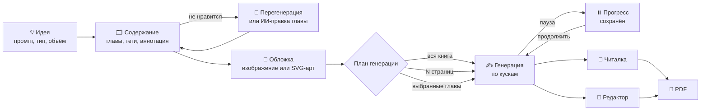

### Почему книга пишется кусками

Модель не может за один запрос качественно написать 200 страниц. Bookich разбивает книгу на разделы, а большие разделы на части, и для каждого куска собирает контекст:

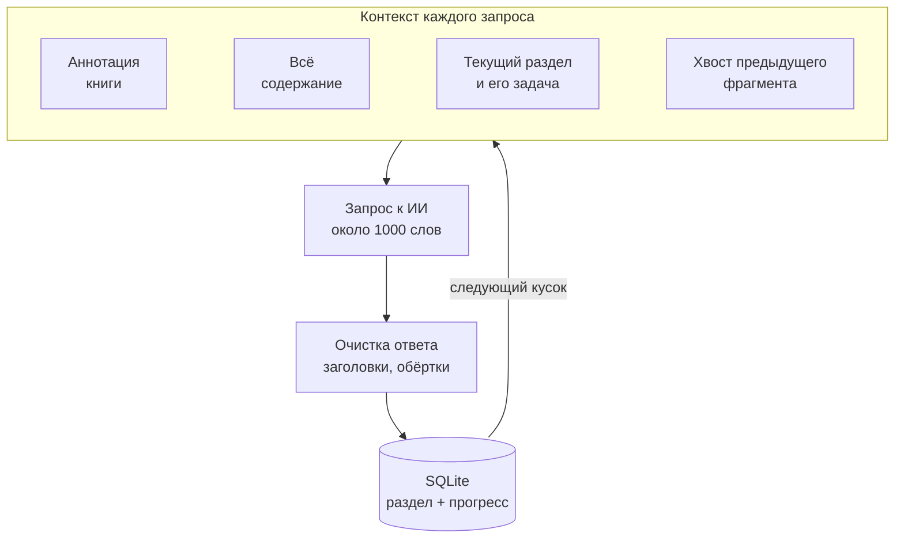

Так текст остаётся связным (модель видит, чем закончился предыдущий фрагмент), не повторяется (видит план целиком) и не теряется (каждый кусок сразу в базе).

### Модель данных

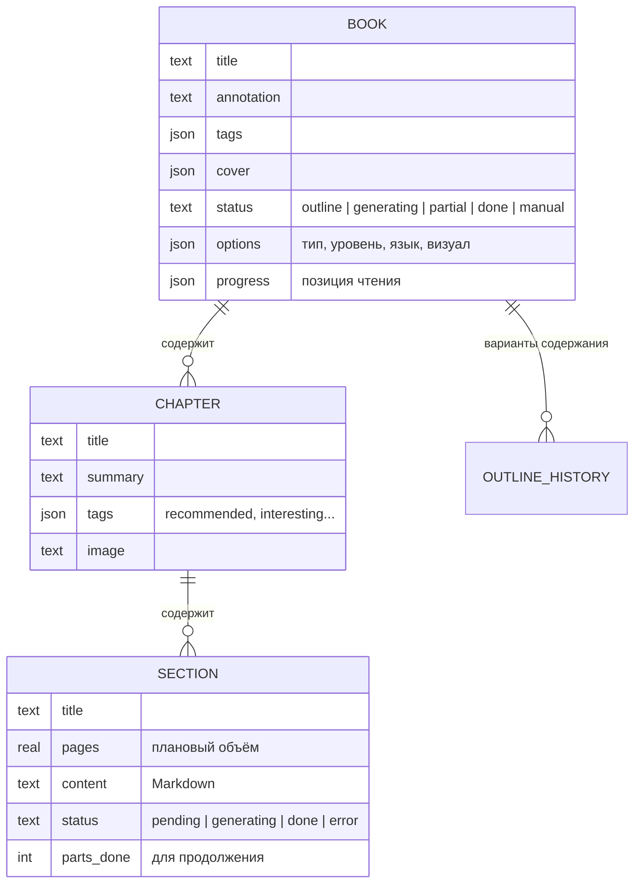

## 🚀 Быстрый старт

### Готовая сборка

Скачайте последний релиз со страницы **Releases** и запустите `Bookich.exe`. Устанавливать Node.js не нужно.

### Из исходников

Нужен [Node.js](https://nodejs.org) 18 или новее.

```bash
git clone https://github.com/<you>/bookich.git
cd bookich
npm install
npm start
```

На Windows можно просто дважды щёлкнуть `start.bat`: при первом запуске он сам установит зависимости.

### Сборка установщика

```bash
npm run dist
```

В папке `dist/` появятся установщик NSIS и портативная версия.

## 🔌 Подключение ИИ

Откройте **Настройки → Провайдер ИИ**.

### Claude CLI (рекомендуется)

Работает через вашу подписку Claude, API-ключ не нужен.

```powershell
# 1. Установите Claude Code
irm https://claude.ai/install.ps1 | iex

# 2. Войдите в аккаунт (один раз)
claude
# внутри введите /login, затем /exit
```

В Bookich нажмите **«Найти автоматически»** и **«Проверить подключение»**. Можно указать модель, например `sonnet` или `opus`.

### OpenAI API

Вставьте ключ, он хранится локально в зашифрованном виде (Windows DPAPI). Настраиваются:

| Параметр | По умолчанию | Назначение |
|---|---|---|
| Текстовая модель | `gpt-4.1` | Содержание и текст книги |
| Модель изображений | `gpt-image-1` | Обложки и иллюстрации к главам |
| Base URL | `https://api.openai.com/v1` | Любой совместимый сервер: LM Studio, OpenRouter и другие |

> 💡 Можно комбинировать: текст через Claude CLI, а обложки-изображения через OpenAI.

## 🏗️ Архитектура

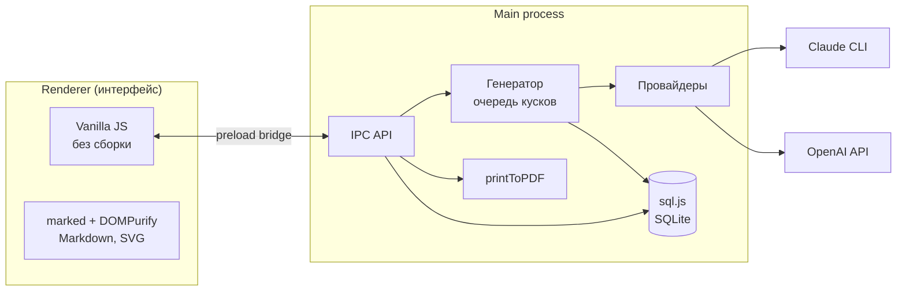

```
bookich/
├── main.js              главный процесс: окно, IPC, настройки, журнал
├── preload.js           безопасный мост к интерфейсу
├── src/
│   ├── db.js            SQLite: книги, главы, разделы, история содержания
│   ├── export.js        PDF и Markdown
│   └── ai/
│       ├── providers.js Claude CLI, OpenAI, поиск claude, повторы
│       ├── prompts.js   промпты содержания, разделов, обложек
│       ├── generator.js очередь генерации по кускам, обложки
│       └── mock.js      демо-провайдер для разработки
├── renderer/
│   ├── index.html       оболочка приложения
│   ├── print.html       вёрстка книги для PDF
│   ├── styles.css       светлая голубая тема
│   └── js/views/        библиотека, книга, читалка, редактор, мастер, настройки
├── assets/              иконки
└── docs/                скриншоты и пример PDF
```

### Технологии

| Слой | Что используется | Почему |
|---|---|---|
| Оболочка | Electron 34 | Нативное окно Windows, Chromium для вёрстки и PDF |
| База | SQLite через sql.js (WebAssembly) | Без нативной компиляции, один файл `bookich.db` |
| Интерфейс | Vanilla JS, ES-модули | Нет сборщика, быстрый старт |
| Markdown | marked + DOMPurify | Безопасный рендер, встроенные SVG-схемы |
| PDF | `webContents.printToPDF` | Векторный текст и схемы, закладки по главам |
| ИИ | Claude CLI (`claude -p`), OpenAI Chat и Images | Подписка или ключ, на выбор |

## 🎨 Дизайн

- Светлая тема с голубым акцентом `#2479f2`
- Анимации 120-170 мс: плавные, но быстрые, не мешают при частом использовании
- Если в Windows отключены анимации, приложение тоже их отключает
- Типографика: Segoe UI Variable для интерфейса, засечки для чтения

## 🗂️ Где хранятся данные

| Что | Где |
|---|---|
| База книг | `%APPDATA%\Bookich\bookich.db` |
| Обложки и иллюстрации | `%APPDATA%\Bookich\media\` |
| Журнал запуска | `bookich-log.txt` рядом с `Bookich.exe` |

Папку данных можно открыть из **Настроек**.

## 🧪 Для разработчиков

Демо-режим подменяет ИИ локальной заглушкой, чтобы проверить интерфейс без затрат:

```powershell
$env:BOOKICH_MOCK=1; npm start
```

Автотест всего сценария (мастер, генерация, читалка, редактор, PDF):

```bash
BOOKICH_MOCK=1 BOOKICH_SELFTEST=1 npx electron .
```

Скриншоты для README:

```bash
BOOKICH_MOCK=1 BOOKICH_SCREENSHOTS=docs/screenshots npx electron . --force-device-scale-factor=2
```

## 🛣️ Планы

- [ ] Тёмная тема для чтения
- [ ] Экспорт в EPUB
- [ ] Импорт PDF и EPUB в библиотеку
- [ ] Anthropic API как третий провайдер
- [ ] Озвучка глав

## 📄 Лицензия

[MIT](LICENSE)

<div align="center">
<sub>Сделано с любовью к книгам и голубому цвету 💙</sub>
</div>
